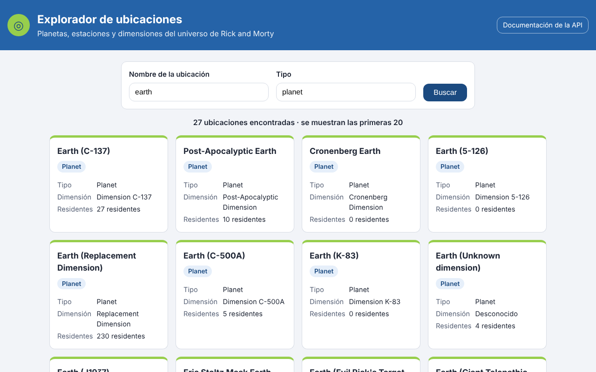

# Explorador de ubicaciones · Rick and Morty

Página web de una sola pantalla para buscar las ubicaciones del universo de Rick and Morty
(planetas, estaciones espaciales, dimensiones…) por nombre y por tipo, usando la API pública
de Rick and Morty. Los resultados se muestran en tarjetas y la última búsqueda se recuerda
al volver a abrir la página.

**Autor:** Javier Riveros · Fundamentos de Desarrollo Web · UCSA
**Variante del TP:** B · Ubicaciones (último dígito de cédula: 5)

## Sitios publicados

- GitHub Pages: https://chabisitoo.github.io/tp-riveros-javier/
- Vercel: https://tp-riveros-javier.vercel.app/

## Captura



## Funcionalidades

- Búsqueda por **nombre** (`name`) y por **tipo** (`type`), combinados en la misma petición.
- Aviso si se intenta buscar sin ningún criterio (no se hace la petición).
- Tarjetas con nombre, tipo, dimensión y cantidad de residentes; los datos vacíos o `unknown` se muestran como «Desconocido».
- Contador de resultados (la API devuelve hasta 20 por página).
- Estado «Buscando…» con el botón deshabilitado mientras dura la petición.
- Mensajes distintos para «sin resultados» (la API responde 404) y para errores de conexión.
- La última búsqueda se guarda en `localStorage` y se repite automáticamente al recargar.
- Diseño responsive: la grilla de tarjetas cambia de columnas sola y funciona a 375 px de ancho.

## Tecnologías

- HTML5 semántico (`header`, `main`, `footer`, `form` con `label`).
- CSS3: variables en `:root`, Flexbox (encabezado), Grid con `repeat(auto-fill, minmax())` (tarjetas) y media queries.
- JavaScript (ES6+): arrow functions, `const`/`let`, `async`/`await`, `try`/`catch`/`finally`.
- Fetch API, `new URL()` y `searchParams`.
- `localStorage`.
- [The Rick and Morty API](https://rickandmortyapi.com/documentation) · endpoint `/api/location`.

## Estructura del proyecto

```
tp-riveros-javier/
├── index.html        → estructura de la página: encabezado, buscador, resultados y pie
├── README.md         → esta documentación
├── .gitignore        → archivos que Git no debe versionar
├── css/
│   └── estilos.css   → variables, layout (Flexbox/Grid), tarjetas y diseño para celular
├── js/
│   └── app.js        → lógica: criterios, petición a la API, tarjetas, estados y localStorage
└── img/
    ├── captura.png   → captura usada en este README
    └── favicon.svg   → ícono de la pestaña
```

Organización de `js/app.js`:

| Sección | Funciones |
|---|---|
| Criterios | `limpiarTexto`, `leerCriterios`, `hayCriterios`, `completarFormulario` |
| Persistencia | `guardarBusqueda`, `leerBusquedaGuardada` |
| Acceso a la API | `construirUrl`, `buscarUbicaciones` (404 → cero resultados) |
| Renderizado | `crearDato`, `crearTarjeta`, `mostrarUbicaciones`, `mostrarContador` |
| Estados | `mostrarMensaje`, `activarCarga`, `describirError` |
| Flujo | `realizarBusqueda`, `manejarEnvio`, `restaurarUltimaBusqueda` |

## Cómo ejecutarlo localmente

1. Clonar el repositorio:
   ```bash
   git clone https://github.com/USUARIO/tp-riveros-javier.git
   ```
2. Abrir `index.html` en el navegador (o con la extensión Live Server de VS Code).

No necesita instalación ni dependencias: es HTML, CSS y JavaScript puros.

## Despliegue

El sitio se publica automáticamente desde la rama `main`, en dos plataformas:

- **GitHub Pages:** *Settings → Pages → Deploy from a branch → `main` / `(root)`*.
- **Vercel:** proyecto importado desde GitHub con *Framework Preset: Other*, sin comando de build y con la raíz del repositorio como directorio de salida.

Cada `git push` a `main` dispara un despliegue nuevo en ambas plataformas, sin subir archivos
a mano. El número de versión del pie (`<span id="version">`) se usa para comprobar que las dos
URL muestran la última versión.
